<!--
  © 2026 Hassan Ali — github.com/Hassan0703
  Original design, artwork and copy. All rights reserved. See LICENSE.
  Every asset carries an embedded authorship fingerprint (ha0703-*).
-->

<a href="https://www.hassanalifrappe.dev/"></a>
<a href="https://www.hassanalifrappe.dev/"></a><a href="https://www.linkedin.com/in/hassan-ali-frappe-dev"></a><a href="mailto:hassan4185767@gmail.com"></a><a href="https://github.com/Hassan0703?tab=repositories"></a>
<a href="https://www.hassanalifrappe.dev/"></a>
<a href="https://github.com/Hassan0703?tab=repositories"></a>
<a href="https://github.com/Hassan0703/frappe-erpnext-engineering-assistant"></a>
<a href="https://github.com/Hassan0703/everest-invoice-system"></a><a href="https://www.hassanalifrappe.dev/"></a>
<a href="https://github.com/Hassan0703?tab=repositories"></a>
<a href="https://www.hassanalifrappe.dev/"></a>
<a href="https://github.com/Hassan0703?tab=repositories"></a>
<a href="mailto:hassan4185767@gmail.com"></a>

<b>Read this profile as plain text</b> (screen readers, small screens, every link)

### Hassan Ali — Frappe / ERPNext Developer
Lahore, Pakistan · Open to work · [hassanalifrappe.dev](https://www.hassanalifrappe.dev/)

> I don't just write code — I solve business problems with smart ERP solutions.

I build scalable ERP systems on Frappe and ERPNext that reduce manual work, streamline operations and support business growth.

**Now** — TradeFlow ERP Platform (building) · Enterprise ERP Apps (active) · AI Desktop Companion (exploring) · Open Source Components (sharing) · Modern Portfolio (live)

**Selected work**
1. **TradeFlow ERP** — trade & import management for ERPNext *(in development)*
2. **[Frappe/ERPNext Engineering Assistant](https://github.com/Hassan0703/frappe-erpnext-engineering-assistant)** — AI agent skill for Frappe v15 & v16
3. **[Everest Invoice System](https://github.com/Hassan0703/everest-invoice-system)** — offline desktop invoicing (Flask, SQLite)
4. **[NxT Car Rental](https://github.com/Hassan0703/NxT-Car-Rental-Management)** — rental management on Frappe / ERPNext
5. **Property RMS** — property management built on ERPNext
6. **[Gifoy Shop](https://github.com/Hassan0703/Gifoy-shop-Ecommerce-Store-Frape-Integration)** — e-commerce × ERPNext integration
7. **[FinPilot](https://github.com/Hassan0703/fin-pilot)** — AI-powered personal finance OS
8. **[Gold Elite](https://github.com/Hassan0703/gold-elite-vscode-theme)** — premium VS Code theme
9. **[Nexilo](https://hassan0703.github.io/Nexilo-Website---Frontend-Only-/)** — P2P lending website
10. **FrapXel** — ERP automation studio website
11. **[Custom Naming Series](https://github.com/Hassan0703/Custom-Namming-Series)** · 12. **[ERPNext Email Setup Guide](https://github.com/Hassan0703/erpnext-email-setup-guide)**

**Stack** — Frappe · ERPNext · Python · JavaScript · Vue 3 · Jinja2 · HTML/CSS · MariaDB · Redis · Linux · WordPress · Git

**Credentials** — ERPNext Professional (Frappe Technologies, 2024) · Python Development (Python Institute, 2023) · SQL & Database Design (LinkedIn Learning)

**Contact** — [hassan4185767@gmail.com](mailto:hassan4185767@gmail.com) · [LinkedIn](https://www.linkedin.com/in/hassan-ali-frappe-dev) · [GitHub](https://github.com/Hassan0703)

© 2026 Hassan Ali. Design, artwork and copy are original and all rights reserved — please don't copy this profile. Fonts: Manrope (SIL OFL 1.1).
